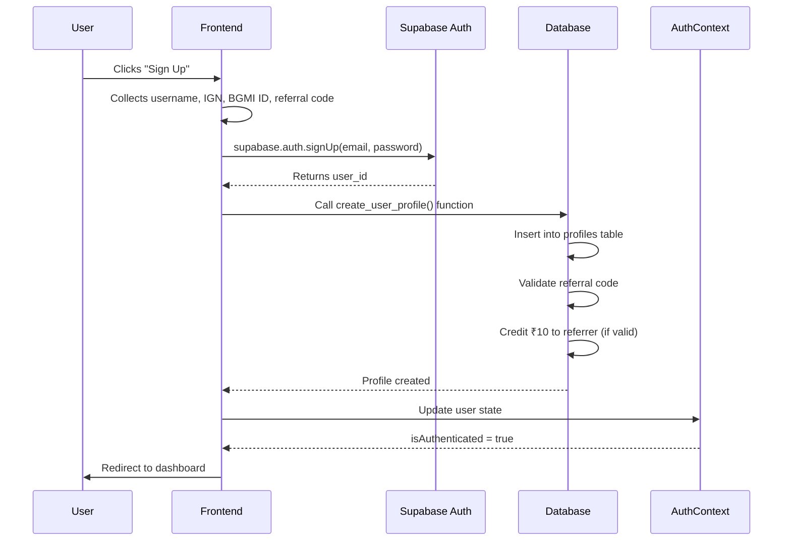
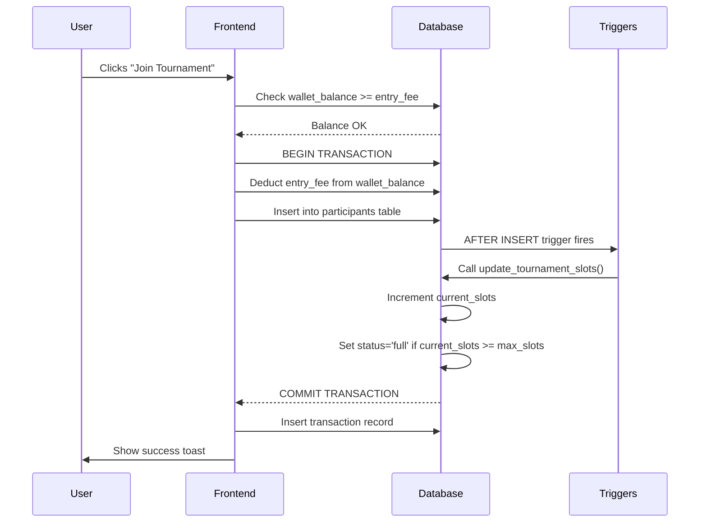
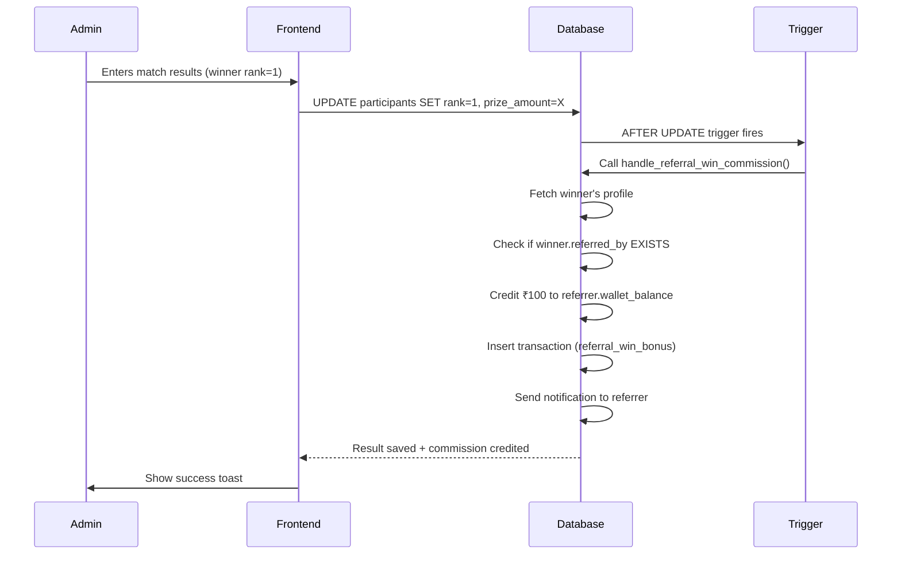
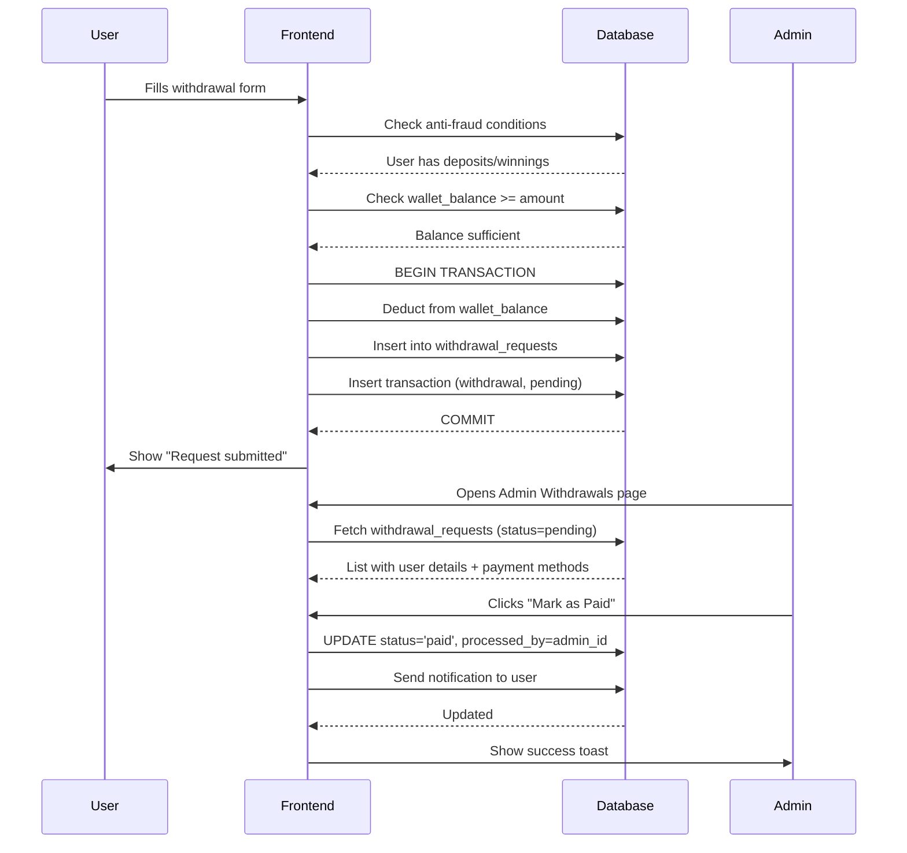

# ArenaX Esports - Technical Documentation

**Version:** 1.0  
**Last Updated:** November 22, 2025  
**Project Type:** BGMI Tournament Platform (Real Money Gaming)

---

## 1. Tech Stack & Architecture

### Frontend Stack
- **Framework:** React 18.3.1 with TypeScript
- **Build Tool:** Vite (Fast bundler with HMR)
- **Routing:** React Router DOM v6.30.1
- **State Management:** TanStack Query v5.83.0 (Server state caching)
- **Styling:** Tailwind CSS v3.x with custom design tokens
- **UI Components:** shadcn/ui (Radix UI primitives)
- **Form Management:** React Hook Form v7.61.1 + Zod v3.25.76 (Validation)
- **Notifications:** Sonner (Toast notifications)
- **Payment Gateway:** Razorpay Integration

### Backend Stack (Lovable Cloud - Supabase)
- **Database:** PostgreSQL (Supabase)
- **Authentication:** Supabase Auth (Email/Password)
- **Real-time:** Supabase Realtime (Websockets)
- **Edge Functions:** Deno (tournament-reminders)
- **Storage:** Supabase Storage (Future use)
- **Security:** Row Level Security (RLS) policies

### Key Libraries
```json
{
  "@supabase/supabase-js": "^2.84.0",
  "@tanstack/react-query": "^5.83.0",
  "react-hook-form": "^7.61.1",
  "zod": "^3.25.76",
  "lucide-react": "^0.462.0",
  "date-fns": "^3.6.0",
  "sonner": "^1.7.4"
}
```

---

## 2. Database Schema (Current Status)

### Core Tables

#### `profiles`
**Purpose:** Extended user data beyond Supabase Auth  
**Key Columns:**
- `id` (uuid, FK to auth.users)
- `username`, `ign` (In-Game Name), `bgmi_id`
- `wallet_balance` (numeric) - Real cash
- `bonus_balance` (numeric) - Referral bonuses
- `total_deposited`, `total_winnings`
- `referral_code` (unique, auto-generated)
- `referred_by` (uuid, FK to profiles)
- `device_id`, `signup_ip`, `last_ip` (Anti-fraud)
- `is_banned` (boolean)

**RLS Policies:**
- Users: Read/Update own profile
- Admins: Full access via `has_role()`
- Public: Can lookup referral codes

---

#### `tournaments`
**Purpose:** Store tournament/match details  
**Key Columns:**
- `id` (uuid)
- `title`, `map` (Erangel/Livik), `match_type` (Solo/Squad)
- `entry_fee`, `prize_pool`, `per_kill_prize`
- `max_slots`, `current_slots` (auto-updated via trigger)
- `start_time` (timestamptz)
- `status` (upcoming/open/full/live/completed/cancelled)
- `created_by` (uuid, admin who created it)

**RLS Policies:**
- Public: Read all tournaments
- Admins: Create/Update/Delete

**Triggers:**
- `update_tournament_slots()` - Auto-increment/decrement `current_slots` on participant join/leave

---

#### `participants`
**Purpose:** Track users enrolled in tournaments  
**Key Columns:**
- `id` (uuid)
- `tournament_id` (FK to tournaments)
- `user_id` (FK to profiles)
- `pubg_id` (User's BGMI ID)
- `payment_status` ('pending'/'paid')
- `rank`, `kills` (Result data)
- `prize_amount` (numeric)
- `joined_at` (timestamptz)

**RLS Policies:**
- Users: Create own participant record, view own records
- Users: View participants in tournaments they're enrolled in
- Admins: View/Update all

**Triggers:**
- `handle_referral_win_commission()` - Credits ₹100 to referrer when rank=1

---

#### `tournament_secrets`
**Purpose:** Store Room ID & Password securely  
**Key Columns:**
- `id` (uuid)
- `tournament_id` (FK to tournaments, unique)
- `room_id`, `room_password` (encrypted text)

**RLS Policies:**
- Admins: Full access
- Paid Participants: Read-only (15 mins before start_time)

---

#### `transactions`
**Purpose:** Financial audit trail  
**Key Columns:**
- `id` (uuid)
- `user_id` (FK to profiles)
- `amount` (numeric)
- `type` (deposit/withdrawal/refund/entry_fee/prize_win/referral_signup_bonus/referral_win_bonus)
- `status` (pending/success/failed)
- `razorpay_order_id`, `razorpay_payment_id`
- `description` (text)
- `metadata` (jsonb)
- `created_at`

**RLS Policies:**
- Users: Create/Read own transactions
- Admins: Read all

---

#### `withdrawal_requests`
**Purpose:** User withdrawal queue for admin processing  
**Key Columns:**
- `id` (uuid)
- `user_id` (FK to profiles)
- `amount` (numeric)
- `payment_method_id` (FK to user_payment_methods)
- `status` (pending/paid/rejected)
- `admin_notes` (text)
- `processed_by` (uuid, admin user_id)
- `processed_at` (timestamptz)

**RLS Policies:**
- Users: Create/Read own requests
- Admins: View/Update all

---

#### `user_payment_methods`
**Purpose:** Store bank/UPI details for withdrawals  
**Key Columns:**
- `id` (uuid)
- `user_id` (FK to profiles, unique)
- `upi_id_1`, `upi_id_2`
- `bank_account_no`, `bank_ifsc`, `bank_name`
- `is_locked` (boolean) - Prevents editing after first save
- `locked_at` (timestamptz)

**RLS Policies:**
- Users: CRUD own payment methods
- Admins: Full access

**Triggers:**
- `prevent_locked_payment_update()` - Blocks edits to locked fields (anti-fraud)

---

#### `notifications`
**Purpose:** In-app notification system  
**Key Columns:**
- `id` (uuid)
- `user_id` (FK to profiles)
- `title`, `message` (text)
- `type` (system/tournament/withdrawal/affiliate)
- `is_read` (boolean)
- `created_at`

**RLS Policies:**
- Users: Read/Update own notifications
- Admins: Full access
- System: Can insert (for triggers)

---

#### `user_roles`
**Purpose:** Role-based access control (RBAC)  
**Key Columns:**
- `id` (uuid)
- `user_id` (FK to auth.users)
- `role` (enum: 'user'/'admin')

**RLS Policies:**
- Users: Read own role, insert 'user' role only
- Super Admin (ashadislam333@gmail.com): Full CRUD

**Security:**
- Uses `has_role()` function (SECURITY DEFINER) to avoid RLS recursion

---

#### `platform_settings`
**Purpose:** Dynamic configuration (e.g., Razorpay keys)  
**Key Columns:**
- `id` (uuid)
- `setting_key` (text, unique) - e.g., 'razorpay_key_id'
- `setting_value` (text)
- `description` (text)
- `created_at`, `updated_at`

**RLS Policies:**
- Admins: Full access
- Public: Read 'razorpay_key_id' only

---

### Key Database Functions

#### `has_role(_user_id uuid, _role app_role) RETURNS boolean`
**Purpose:** Check if user has a specific role  
**Type:** SECURITY DEFINER (bypasses RLS, prevents recursion)  
**Usage in RLS:**
```sql
CREATE POLICY "Admins can view all" 
ON public.tournaments 
FOR SELECT 
USING (has_role(auth.uid(), 'admin'));
```

---

#### `create_user_profile(...)`
**Purpose:** Atomic profile creation with referral bonus logic  
**Prevents:** Duplicate referral bonuses via idempotency check  
**Called by:** Frontend during signup

---

#### `credit_referral_bonus(referrer_id uuid, new_user_name text)`
**Purpose:** Credit ₹10 to referrer on new signup  
**Side Effects:**
- Updates `profiles.bonus_balance`
- Inserts `transactions` record
- Sends notification

---

#### `handle_referral_win_commission()` (Trigger Function)
**Purpose:** Credit ₹100 to referrer when referred user wins (rank=1)  
**Trigger:** AFTER UPDATE on `participants`  
**Logic:**
```sql
IF NEW.rank = 1 AND (OLD.rank IS NULL OR OLD.rank != 1) THEN
  -- Update referrer's wallet_balance (+₹100)
  -- Insert transaction
  -- Send notification
END IF;
```

---

#### `cancel_tournament(match_id uuid)`
**Purpose:** Admin cancellation with automatic refunds  
**Steps:**
1. Fetch entry_fee from tournaments
2. Loop through all paid participants
3. Refund to wallet_balance
4. Insert refund transaction
5. Send apology notification
6. Delete participants
7. Set tournament status = 'cancelled'

---

#### `update_tournament_slots()` (Trigger Function)
**Purpose:** Auto-update current_slots on participant INSERT/DELETE  
**Logic:**
- INSERT: current_slots++, set status='full' if current_slots >= max_slots
- DELETE: current_slots--, set status='open' if was 'full'

---

#### `check_duplicate_accounts()` (Trigger Function)
**Purpose:** Anti-fraud device/IP tracking  
**Logic:**
- BEFORE INSERT on profiles
- Count accounts from same signup_ip or device_id
- Allow unlimited for admin device (ashadislam333@gmail.com)
- Limit to 2 accounts for public devices
- RAISE EXCEPTION if limit exceeded

---

#### `prevent_locked_payment_update()` (Trigger Function)
**Purpose:** Lock payment methods after first save (anti-fraud)  
**Logic:**
- BEFORE UPDATE on user_payment_methods
- If is_locked=true, prevent changes to bank/UPI fields
- Admin can bypass via has_role()

---

### Edge Functions

#### `tournament-reminders`
**Location:** `supabase/functions/tournament-reminders/index.ts`  
**Purpose:** Send notifications 15 mins before tournament start_time  
**Trigger:** Scheduled cron job (Supabase)  
**Tech:** Deno runtime

---

## 3. Key Features & Functionality

### User Features

#### **Authentication**
- **Signup:** Email/Password with username, IGN, BGMI ID
- **Login:** Email/Password
- **Protected Routes:** Auto-redirect to `/login` if not authenticated
- **Device Tracking:** Records device_id and signup_ip for anti-fraud
- **Auto-confirm Email:** Enabled in Supabase (no email verification for testing)

#### **Wallet System**
- **Deposit:** Razorpay integration (fetches key from platform_settings)
- **Balance Types:**
  - `wallet_balance`: Real cash (deposits + winnings)
  - `bonus_balance`: Referral rewards (₹10 signup, ₹100 win commission)
- **Withdrawal:** Request system with admin approval
  - Anti-fraud: Requires prior deposits OR winnings to enable
  - Min: ₹100, Max: ₹10,000 per request
  - Payment methods locked after first save
- **Transaction History:** Full audit trail with type filtering

#### **Tournament System**
- **Browse:** View all upcoming/open tournaments
- **Join:** Pay entry fee from wallet (deducts amount, creates participant record)
- **Room Details:** Access Room ID/Password 15 mins before start_time (RLS enforced)
- **Results:** View rank, kills, prize amount after admin updates

#### **Referral/Affiliate System**
- **Unique Code:** Auto-generated 8-char code on signup
- **Invite Link:** `https://arenax.app?ref=ABCD1234`
- **Earnings:**
  - ₹10 bonus on signup
  - ₹100 wallet cash when referred user wins (rank=1)
- **Dashboard:** Total signups, active depositors, matches played, total earnings

#### **Leaderboard**
- **Global Rankings:** Top players by total_winnings
- **Filters:** All-time, Monthly, Weekly
- **Stats:** Username, IGN, Wins, Kills, Earnings

---

### Admin Features

#### **Dashboard (`/admin`)**
- **Stats Cards:**
  - Total Users, Active Tournaments, Revenue, Withdrawals Pending
- **Recent Activity:** Latest transactions and user signups
- **Quick Actions:** Create Tournament, Manage Withdrawals

#### **Tournament Management (`/admin/tournaments`)**
- **Create Match:**
  - Map (Erangel/Livik), Type (Solo/Squad)
  - Entry Fee, Prize Pool, Per Kill Prize
  - Max Slots, Start Time
  - Auto-calculates profit: `(entry_fee × max_slots) - prize_pool`
- **Edit:** Pre-filled modal for existing tournaments
- **Delete:** Only if current_slots = 0 (no users joined)
- **Cancel:** Triggers `cancel_tournament()` function (auto-refunds)
- **Update Room ID/Password:** Stores in `tournament_secrets`
- **Enter Results:**
  - Select winner username
  - Input kills
  - Click "Distribute Prize" → Credits wallet + creates transaction

#### **Withdrawals (`/admin/withdrawals`)**
- **View Requests:** Shows pending/paid/rejected with user details
- **Payment Methods:** Displays UPI IDs, Bank Account details
- **Actions:**
  - **Mark as Paid:** Updates status, sends success notification
  - **Reject & Refund:** Refunds to wallet, inserts refund transaction, notifies user
- **Filters:** All, Pending, Paid, Rejected

#### **User Management (`/admin/users`)**
- **Search:** By username, email, BGMI ID
- **View Details:** Wallet balance, total deposited, winnings
- **Actions:**
  - **Ban User:** Sets `is_banned = true` (blocks login)
  - **Send Money:** Direct wallet credit (bonus or correction)

#### **Referral Management (`/admin/referrals`)**
- **Stats:** Total referrals, commission paid
- **Table:** Who referred whom, join date, bonus status

#### **Platform Settings (`/admin/settings`)**
- **Razorpay Keys:** Update `razorpay_key_id` and `razorpay_key_secret`
- **Upsert Logic:** Uses `.upsert()` with `onConflict: 'setting_key'`
- **Security:** Keys stored in `platform_settings` table

---

### Security Features

#### **Row Level Security (RLS)**
- **All tables have RLS enabled**
- **Pattern:**
  ```sql
  -- Users access own data
  CREATE POLICY "Users read own" ON table_name
  FOR SELECT USING (auth.uid() = user_id);
  
  -- Admins access everything
  CREATE POLICY "Admins full access" ON table_name
  FOR ALL USING (has_role(auth.uid(), 'admin'));
  ```

#### **Protected Routes**
- **Component:** `ProtectedRoute.tsx`
- **Logic:**
  - Shows loading screen while checking auth
  - Redirects to `/login` if no user
  - Only renders children if authenticated

#### **Admin-Only Routes**
- **Layout:** `AdminLayout.tsx`
- **Checks:**
  1. User must be logged in
  2. User must have 'admin' role in `user_roles`
  3. Redirects to homepage with error toast if not admin

#### **Super Admin Bypass**
- **Email:** `ashadislam333@gmail.com`
- **Privileges:**
  - Unlimited accounts from same device/IP
  - Can modify user_roles table
  - Hardcoded in `is_super_admin()` function

#### **Anti-Fraud Measures**
1. **Device Fingerprinting:** Tracks device_id and signup_ip
2. **Account Limits:** Max 2 accounts per device/IP (except admin)
3. **Payment Method Locking:** Can't edit bank/UPI after first save
4. **Withdrawal Guards:**
   - Must have deposits OR winnings
   - Min/Max limits enforced
   - Admin approval required

---

## 4. Folder Structure Overview

```
src/
├── components/              # Reusable UI components
│   ├── ui/                 # shadcn/ui primitives (Button, Dialog, etc.)
│   ├── layout/             # Navbar, Footer, AdminLayout, UserMenu
│   ├── admin/              # Admin-specific components (SendMoneyModal, etc.)
│   ├── affiliate/          # Referral dashboard components
│   ├── cards/              # TournamentCard, AffiliateStepCard
│   ├── icons/              # Custom SVG icons (TelegramIcon)
│   ├── leaderboard/        # Leaderboard table and skeletons
│   ├── profile/            # EditProfileModal, WithdrawalSettings
│   ├── support/            # SupportCard
│   ├── tournaments/        # TournamentRoomDetails
│   ├── wallet/             # DepositModal, WithdrawalModal, skeletons
│   ├── LoadingScreen.tsx   # App intro animation
│   ├── NavLink.tsx         # Custom active link component
│   └── ProtectedRoute.tsx  # Auth guard wrapper
│
├── contexts/               # React Context providers
│   └── AuthContext.tsx    # User auth state, signUp(), signIn(), signOut()
│
├── hooks/                  # Custom React hooks
│   ├── use-mobile.tsx     # Responsive breakpoint detection
│   ├── use-toast.ts       # Toast notification system
│   └── useRazorpay.ts     # Payment gateway integration
│
├── integrations/
│   └── supabase/
│       ├── client.ts      # Supabase client instance (auto-generated)
│       └── types.ts       # Database types (auto-generated from schema)
│
├── lib/
│   ├── deviceFingerprint.ts  # Browser fingerprinting utility
│   └── utils.ts              # cn() helper (clsx + tailwind-merge)
│
├── pages/                  # Route components
│   ├── admin/             # Admin panel pages
│   │   ├── AdminDashboard.tsx
│   │   ├── AdminReferrals.tsx
│   │   ├── AdminSettings.tsx
│   │   ├── AdminUsers.tsx
│   │   ├── AdminWithdrawals.tsx
│   │   └── ManageTournaments.tsx
│   ├── legal/             # Legal pages
│   │   ├── PrivacyPolicy.tsx
│   │   ├── RefundPolicy.tsx
│   │   └── Terms.tsx
│   ├── support/           # Support pages
│   │   ├── ContactUs.tsx
│   │   └── Faq.tsx
│   ├── Affiliate.tsx      # Referral dashboard
│   ├── Auth.tsx           # Login/Signup page
│   ├── Home.tsx           # Landing page
│   ├── HowItWorks.tsx     # Tutorial page
│   ├── Leaderboard.tsx    # Global rankings
│   ├── NotFound.tsx       # 404 page
│   ├── Profile.tsx        # User profile & settings
│   ├── TournamentDetail.tsx  # Match details + join
│   ├── Tournaments.tsx    # Browse all matches
│   └── Wallet.tsx         # Deposit/Withdraw/History
│
├── App.tsx                # Root component with routing
├── main.tsx               # React entry point
├── index.css              # Global styles + Tailwind directives
└── vite-env.d.ts          # Vite type definitions

supabase/
├── config.toml            # Supabase project config (auto-generated)
├── functions/
│   └── tournament-reminders/
│       └── index.ts       # Edge function for notifications
└── migrations/            # SQL migration files (timestamped)

public/
├── favicon.svg
├── logo.png
├── manifest.json
└── robots.txt
```

---

## 5. Authentication Flow



---

## 6. Tournament Join Flow



---

## 7. Referral Commission Flow



---

## 8. Withdrawal Request Flow



---

## 9. Security Best Practices Implemented

### ✅ **Authentication**
- Email/Password via Supabase Auth (bcrypt hashing)
- JWT tokens with auto-refresh
- Protected routes with auth guards
- Session persistence in localStorage

### ✅ **Authorization**
- Role-based access control (RBAC) via `user_roles` table
- `has_role()` function to avoid RLS recursion
- Separate policies for users vs admins

### ✅ **Input Validation**
- Zod schemas on forms (email, password, amounts)
- Frontend validation before API calls
- Backend validation via CHECK constraints and triggers

### ✅ **Financial Security**
- Double-entry accounting via transactions table
- Anti-fraud checks (device_id, signup_ip limits)
- Payment method locking after first save
- Admin approval for withdrawals

### ✅ **Data Privacy**
- RLS policies on ALL tables
- Users can only access own data
- Tournament secrets only visible to paid participants

### ✅ **SQL Injection Prevention**
- Parameterized queries via Supabase client
- No raw SQL from user input
- SECURITY DEFINER functions for safe privilege escalation

---

## 10. Environment Variables

```env
# .env (Auto-generated by Lovable Cloud)
VITE_SUPABASE_URL=https://wcwmadabepmfibowhiuc.supabase.co
VITE_SUPABASE_PUBLISHABLE_KEY=eyJhbGciOiJIUzI1NiIsInR5cCI6IkpXVCJ9...
VITE_SUPABASE_PROJECT_ID=wcwmadabepmfibowhiuc
```

**⚠️ DO NOT EDIT .env MANUALLY** - It's auto-updated by Supabase integration.

---

## 11. Deployment Instructions

### **Development**
```bash
npm install
npm run dev
# App runs on http://localhost:8080
```

### **Production (via Lovable)**
1. Click **Publish** button (top right)
2. Frontend auto-deploys to `yoursite.lovable.app`
3. Backend (Edge Functions, Migrations) deploy automatically
4. Custom domain: Project > Settings > Domains

### **Database Migrations**
- **Auto-deployed:** All SQL files in `supabase/migrations/`
- **Rollback:** Not supported (plan schema changes carefully)
- **Testing:** Use Supabase staging environment (if available)

---

## 12. Known Issues & Future Enhancements

### Current Limitations
- ❌ No email verification (auto-confirm enabled for testing)
- ❌ No SMS notifications (only in-app)
- ❌ No image uploads (avatar URLs are text fields)
- ❌ No real-time match updates (admin enters results manually)

### Planned Features
- 🔄 Automatic result fetching via BGMI API (if available)
- 🔄 Push notifications (Web Push API)
- 🔄 Live leaderboard updates during matches
- 🔄 Tournament brackets for multi-round events
- 🔄 Team management for Squad tournaments
- 🔄 Automated payout via Razorpay Payouts API

---

## 13. Support & Maintenance

### Monitoring
- **Supabase Logs:** Check auth, database, and function logs via Lovable Cloud UI
- **Error Tracking:** Console errors visible in browser DevTools
- **Performance:** Monitor via Supabase Analytics (queries, RLS overhead)

### Backup Strategy
- **Database:** Automatic daily backups by Supabase (retained 7 days on free tier)
- **Code:** Version controlled via Git (GitHub integration)

### Super Admin Contact
**Email:** ashadislam333@gmail.com  
**Role:** Full system access, can modify user_roles, unlimited test accounts

---

## 14. Quick Reference

### Common Admin Tasks
```sql
-- Make user an admin
INSERT INTO user_roles (user_id, role) 
VALUES ('user-uuid-here', 'admin');

-- Ban a user
UPDATE profiles SET is_banned = true WHERE id = 'user-uuid';

-- Cancel tournament with refunds
SELECT cancel_tournament('tournament-uuid');

-- View all pending withdrawals
SELECT * FROM withdrawal_requests WHERE status = 'pending';
```

### Common User Queries
```sql
-- Check my wallet balance
SELECT wallet_balance, bonus_balance FROM profiles WHERE id = auth.uid();

-- My tournament history
SELECT t.title, p.rank, p.kills, p.prize_amount 
FROM participants p
JOIN tournaments t ON p.tournament_id = t.id
WHERE p.user_id = auth.uid()
ORDER BY p.joined_at DESC;

-- My referral stats
SELECT get_affiliate_stats(auth.uid());
```

---

## 15. Credits & Technologies

**Built with:**
- [React](https://react.dev/) - UI framework
- [Vite](https://vitejs.dev/) - Build tool
- [Supabase](https://supabase.com/) - Backend-as-a-Service
- [Tailwind CSS](https://tailwindcss.com/) - Styling
- [shadcn/ui](https://ui.shadcn.com/) - Component library
- [Razorpay](https://razorpay.com/) - Payment gateway
- [Lovable](https://lovable.dev/) - Development platform

**Developed by:** ArenaX Team  
**License:** Proprietary (Real Money Gaming - Licensed)  
**Version:** 1.0.0  
**Last Updated:** November 22, 2025

---

**End of Documentation**